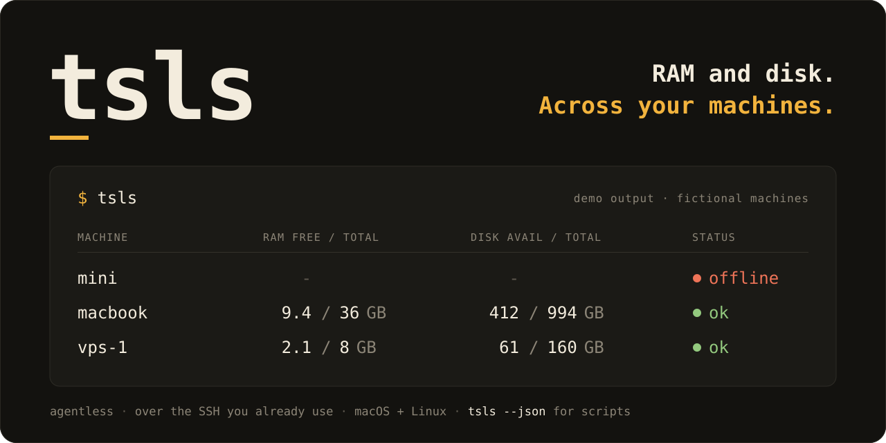

<p align="center">
  
</p>

# tsls

Free RAM and available disk across your macOS and Linux machines. One snapshot, using the SSH access you already have. No remote agent, telemetry, daemon, root access or Tailscale account required. The hero contains fictional demo values, not live machine data.

## Install

Requires Node.js 22 or newer and OpenSSH on the client. The npm package is **`@adinvadim/tsls`**; the installed command is **`tsls`**. The unrelated unscoped `tsls` npm package is not this project.

```sh
npm install -g @adinvadim/tsls
# Or:
pnpm add -g @adinvadim/tsls
bun add -g @adinvadim/tsls
# Run without a global install:
npx @adinvadim/tsls --help
pnpm dlx @adinvadim/tsls --help
bunx @adinvadim/tsls --help
```

Only the development build needs TypeScript. Published JavaScript runs on Node; Bun is optional. macOS and Linux clients and hosts are supported. Windows clients are not yet supported. There are no standalone native binaries or Homebrew formula yet. [GitHub Releases](https://github.com/adinvadim-dev/tsls/releases) also provide an npm tarball and SHA256SUMS for offline installation. Use that verified tarball if npm metadata is still propagating immediately after a new release. Verify `shasum -a 256 -c SHA256SUMS` in the download directory, then `npm install -g ./adinvadim-tsls-0.1.0.tgz`. Checksums detect download corruption; they are not a signature from an independent trust root. Installers never silently overwrite an existing unrelated `tsls` command: check `command -v tsls` before installing.

## Configure once

```sh
tsls init
```

This explicitly creates `~/.config/tsls/config.json`, or `$XDG_CONFIG_HOME/tsls/config.json`, with a local-only host. It refuses to overwrite an existing file. Edit it to name your own machines. These are fictional SSH aliases:

```json
{
  "version": 1,
  "timeout": 5,
  "concurrency": 4,
  "hosts": [
    { "label": "laptop", "transport": "local" },
    { "label": "buildbox", "transport": "ssh", "target": "buildbox" },
    { "label": "dev-vm", "transport": "ssh", "target": "developer@dev-vm.example" }
  ]
}
```

Set up and verify SSH access and trusted host keys yourself first. `tsls` respects your SSH aliases and ProxyJump. It enforces `BatchMode=yes` and `StrictHostKeyChecking=yes`, so it neither asks for passwords nor automatically trusts a new key. Passwords and private keys do not belong in this config. Your SSH config remains a trusted executable configuration, including any ProxyCommand you have configured there.

## Take a snapshot

```sh
tsls
tsls laptop buildbox
tsls --timeout 3 --concurrency 4
tsls --json > snapshot.json
tsls --plain | cut -f1,2,3
tsls --config /absolute/path/to/config.json --json
TSLS_TIMEOUT=3 tsls dev-vm
tsls --help
```

The default queries only your configured allowlist. The local transport reads the computer running the command. SSH transport executes a fixed read-only shell probe on the remote host; nothing is installed there. Probes run concurrently with a per-host timeout. An offline host stays in the output with unknown metrics while other hosts keep their readings. Exit code 1 signals a partial snapshot.

Human output shows RAM **free / total**, disk **available / total**, and `ok`, `offline` or `error`. Units are decimal GB. For reliable parsing use `--json` or `--plain`; human formatting can change. There is currently no ANSI output, so `--no-color`, `NO_COLOR` and `TERM=dumb` are naturally respected.

### What the numbers mean

Linux RAM free is `MemFree`, RAM available is `MemAvailable`, and total is `MemTotal` from `/proc/meminfo`. Kernel kB counters are converted with 1024 bytes. Available includes reclaimable memory and is usually more useful for capacity planning. An absent `MemAvailable` remains unknown.

macOS RAM free is exactly `vm_stat`'s `Pages free` times its reported page size, including 16 KiB Apple Silicon pages. Total comes from `sysctl hw.memsize`. Available RAM is `null`: free, inactive and compressed memory cannot simply be added into an equivalent of Linux `MemAvailable`.

Disk available is `df -Pk`'s `Available`, converted from 1024-byte blocks. This is filesystem-reported space available to an ordinary user, not all free blocks; disk free is consequently `null`. Linux probes `/`; macOS probes `/System/Volumes/Data` once. APFS volumes share container capacity, snapshots and purgeable-space accounting affect readings, and Finder's capacity can differ. Never sum macOS root and Data capacities. These are observations collected during a snapshot, not atomic fleet-wide measurements or forecasts.

## Output and failures

JSON has `schemaVersion: 1`, snapshot and per-host ISO timestamps, per-host duration/status, and `metrics` or a structured `error`. Every byte field contains `bytes`, `source` and `quality` (`reported` or `unknown`). Unknown is `null`, never zero. Offline and failed hosts have `metrics: null`. SSH targets, raw stderr and credentials are not echoed into snapshots. `--plain` uses a stable TSV header and empty cells for unknown values. See the [CLI contract](docs/cli.md).

Exit codes: `0` all hosts succeeded; `1` runtime or partial failure; `2` invalid usage/configuration; `130` interrupted. Data goes to stdout; diagnostics go to stderr. Ctrl-C kills active probe process groups and starts no further probes. No retries, background jobs or notifications.

Configuration precedence is flags, then `TSLS_CONFIG`/`TSLS_TIMEOUT`/`TSLS_CONCURRENCY`, then the selected user config, then defaults. Config paths must be absolute. No repository-local config is loaded. Timeout is 1–120 seconds; concurrency is 1–32; at most 100 configured hosts. Target syntax is an SSH alias or hostname, optionally `user@host`. Ports and IPv6 should use an SSH config alias. No arbitrary remote paths or shell commands are accepted. Shell completion is deferred; `--help` documents the small command surface.

## Development

```sh
npm ci
npm run check
```

The local gate runs typecheck, Biome, unit/integration tests and a clean tarball install with bin/JSON smoke checks. Tests use sanitized fixtures and a fake SSH executable for network failures, concurrency, timeouts and cancellation. Native collection is also exercised during the pack check. GitHub Actions checks are intentionally not configured; contributors run the local gate before pushing. See [CONTRIBUTING.md](CONTRIBUTING.md).

Uninstall with `npm uninstall -g @adinvadim/tsls`, or the equivalent package-manager command. This leaves your private config untouched. MIT licensed.
